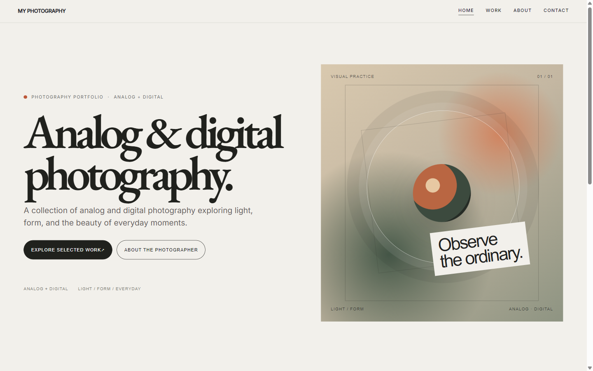
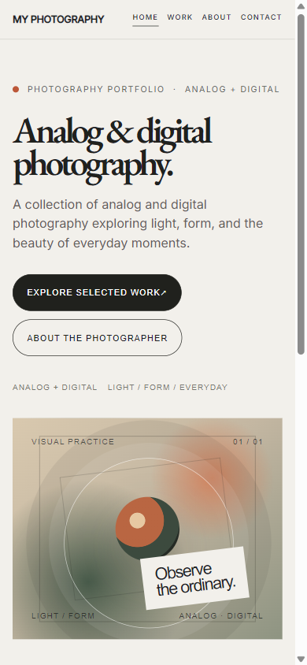
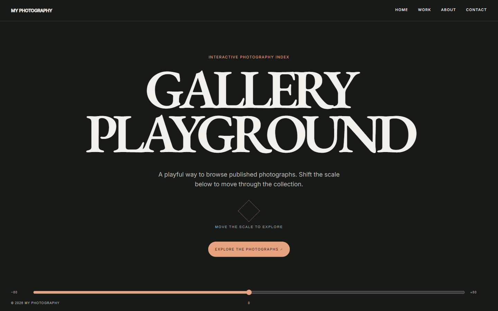

# Đặc tả frontend tham chiếu & hướng dẫn tái sử dụng — Axel Vanhessche

**Mục đích:** tài liệu bàn giao gồm khảo sát giao diện, ánh xạ dữ liệu và hướng dẫn vận hành theme portfolio trong dự án Cimaise. Đây là đặc tả dựa trên hành vi website công khai, không phải bản sao source code.

- Website tham chiếu: [axelvanhessche.com](https://axelvanhessche.com/)
- Ngày khảo sát: 19-10-2026
- Trang đã xem: `/`, `/works`, `/works/{slug}`, `/gallery/`, `/about/`
- Đã xem trực tiếp ở viewport 1280×720; một lượt quan sát ban đầu ở 1662×850.
- Website hiển thị thông báo rằng ảnh được bảo vệ bản quyền. Danh sách asset phía dưới chỉ để nhận diện cách sắp xếp; bản build cần dùng ảnh được sở hữu/cấp phép và font có quyền sử dụng.

## 1. Hướng triển khai trong workspace

Workspace hiện tại là Cimaise: PHP 8.2+, Slim 4, Twig, Tailwind CSS 3 và Vite. Các asset `/_nuxt/` cho thấy site tham chiếu được build bằng Nuxt; cuộn mượt được quan sát trực tiếp nhưng thư viện cụ thể chưa được xác nhận. Bản dựng nên dùng cấu trúc Twig hiện có và giữ nguyên mô hình album/collection của Cimaise, không thay framework ứng dụng.

Đề xuất tách thành 4 loại view, tương ứng 5 mẫu URL (detail dùng slug động):

| Route | Vai trò |
|---|---|
| `/` | Trang chủ portfolio, collage ảnh và dự án nổi bật |
| `/works` | Danh sách dự án chia theo Editorial, Portrait, Commercial |
| `/works/{slug}` | Trang ảnh riêng của một dự án |
| `/gallery` | Gallery thử nghiệm tương tác kiểu canvas |
| `/about` | Tiểu sử, khách hàng, credits và liên hệ |

Dữ liệu cần có: dự án (tiêu đề, nhóm, năm, ảnh bìa, bộ ảnh, thứ tự), ảnh trang chủ, bio, chân dung, danh sách khách hàng, credits và liên kết mạng xã hội/email.

## 2. Hệ thống giao diện chung

### Màu và typography quan sát được

| Token | Giá trị tham chiếu |
|---|---|
| `--black` | `#000` |
| `--white` | `#fff` |
| `--gray` | `#afafaf` |
| Chữ nhỏ trên nền tối | trắng; header/footer thay màu theo nền |
| Đường chia trên About | `#686868` |
| Viền thẻ/danh mục sáng | khoảng `#c8c8c8` |
| Font nội dung | Neue Montreal, 16px / 20px cơ bản |
| Font tiêu đề display/logo | Bulevar Regular |

Website dùng kiểu chữ uppercase nhiều, tracking chặt, tương phản kích cỡ mạnh. Logo wordmark và tiêu đề trang dùng Bulevar; nội dung và menu dùng Neue Montreal. Nếu không có license font, dùng font thay thế được cấp phép có dáng sans condensed cho display và grotesk trung tính cho nội dung.

### Lưới, khoảng cách và breakpoint

- Desktop: lưới 24 cột, gutter 30px, lề ngang 30px; khu vực chính thường bằng 100vh.
- Điện thoại: lưới 6 cột, lề ngang 20px; bố cục chuyển sang xếp dọc.
- CSS dùng `max-width: 430px` cho mobile, `min-width: 769px` cho desktop; có ngoại lệ màn hình tối đa 375×667 và điều chỉnh crop ở màn rất rộng từ 1919px/2499px.
- Header cố định trên viewport, padding desktop 30px; logo neo trên trái (xấp xỉ 24px), khối mô tả và ngày cập nhật nằm giữa, menu chính ở góc phải.
- Link menu có hai lớp chữ để tạo chuyển động hover. Active link có màu đậm hơn; trên nền tối logo/menu chuyển trắng.
- Chuyển cảnh và reveal chữ/ảnh dùng easing kéo dài khoảng 0.35–1.25 giây. Cuộn mượt và parallax là phần quan trọng của cảm giác giao diện.
- Có loader khi mở trang chủ, hiển thị tiến độ từ 0% đến 100% trước khi nội dung ổn định.

### Điều hướng dùng chung

Logo **AXEL VANHESSCHE** và menu dẫn tới **INDEX**, **WORK**, **GALLERY**, **ABOUT**. Khối thông tin cố định hiển thị “PHOTOGRAPHER FROM / FRANCE BASED IN PARIS” và “LAST UPDATE / FEB 2025”. Footer có liên kết Instagram, Email, copyright, dấu logo nhỏ và ngày cập nhật. Đây là nội dung của site tham chiếu; theme tái sử dụng phải lấy tên, mô tả và liên kết từ cấu hình website, không hard-code danh tính Axel.

Mobile CSS cho thấy menu toàn màn hình: link cỡ khoảng 46px, xếp dọc, mục active rõ hơn các mục còn lại, có nút đóng. Chưa mô phỏng viewport điện thoại trực tiếp; cần xác minh hành vi này khi dựng.

## 3. Trang chủ `/`

### Cấu trúc từ trên xuống

1. **Hero:** nền trắng, wordmark đen cực lớn ở trái. Header nhỏ nằm trên cùng; ảnh dọc lớn đặt lệch về phải, ảnh nhỏ thứ hai ở sát trái phía dưới. Thông báo bản quyền đặt giữa các ảnh.
2. **Collage/parallax:** 7 ảnh dọc/ngang rải lệch nhau trên lưới 24 cột. Khoảng trống lớn, mỗi ảnh được crop/scale và dịch chuyển parallax khi cuộn; không dùng gallery card đồng đều.
3. **Selected projects:** hai dự án full-screen, ảnh phủ toàn khung, lớp gradient tối, metadata dạng pill và tên dự án cỡ display ở gần đáy. Tên dự án: **RÊVE GÉNÉRAL — Editorial, 2025** và **ROAD TRIP — Editorial, 2023**. Click mở trang dự án tương ứng.
4. **Footer CTA:** hai nút pill viền lớn **INSTAGRAM ↗** và **EMAIL ↗**; dưới cùng có rule mảnh, copyright trái, biểu tượng giữa, ngày cập nhật phải.

Ảnh feature ở các project card có mask/transition dạng wipe hoặc star khi cuộn qua; desktop phần project chồng lên cuối collage. Home page dài, desktop khoảng 6,816px ở viewport 1280×720.

### Ảnh nhìn thấy trên trang chủ

Các asset dưới đây nằm dưới `/images/` trên website tham chiếu. Kích thước là intrinsic size quan sát trong browser. Danh sách ghi nhận 9 ảnh collage/ảnh xuất hiện quanh trang chủ; đây không khẳng định cả 9 đều nằm trong cùng một màn hình đầu.

| Vị trí/nhóm | Tên file tham chiếu | Kích thước |
|---|---|---:|
| Collage | `audreyf_web2.jpg` | 1600×2000 |
| Collage | `ELECTRICK-1.webp` | 1280×1600 |
| Collage | `peugeot_153.webp` | 1333×2000 |
| Collage | `denzelcurry14822.webp` | 640×800 |
| Collage | `3g0a9005.webp` | 1280×1600 |
| Collage | `LARELEVE-1.webp` | 1280×1600 |
| Collage | `AVE20231220_18444255_0090.webp` | 1142×1600 |
| Collage | `portraits-11_benoitmagimel.webp` | 1280×1600 |
| Collage | `LARELEVE-5.webp` | 1280×1600 |
| Feature, có vẻ Rêve Général | `glamwork_1.jpg` | 2000×1333 |
| Feature, có vẻ Road Trip | `peugeot_385.webp` | 2000×1333 |

## 4. Work archive `/works`

### Bố cục và điều hướng

- Trang nằm trong một viewport cao 100vh nhưng rộng hơn màn hình; tại 1280×720 phần tử ngang khoảng 4,189px. Đây là trải nghiệm cuộn ngang, không phải danh sách dọc thông thường.
- Tiêu đề **ALL WORKS** khổng lồ neo ở đáy bên trái; cỡ khoảng 275px trên desktop, giảm còn khoảng 144px trên mobile.
- Các cụm chữ tên dự án/khách hàng nằm trên vùng tiêu đề; ba cột category card chạy ngang theo thứ tự **EDITORIAL 01**, **PORTRAIT 02**, **COMMERCIAL 03**.
- Mỗi category có nhãn dọc xoay -90°, dạng pill hẹp/sticky; ảnh card phủ đủ chiều cao viewport, crop `object-fit: cover`, có gradient tối ở đáy.
- Hover/reveal đưa ảnh từ scale lớn về trạng thái rõ hơn và hiện metadata pill + title. Click card điều hướng tới `/works/{slug}`.
- Trên mobile CSS chuyển `.works-page` thành block cao tự nhiên; card tỷ lệ khoảng 390:487, title canh trái và category được đưa về bố cục dọc.

### Danh sách card quan sát được

| Nhóm | Card | Năm | Ảnh cover tham chiếu |
|---|---|---:|---|
| Editorial | RÊVE GÉNÉRAL | 2025 | `glamwork_3.jpg` |
| Editorial | DRIVE MY STAR | 2024 | `audreyf_web2.jpg` |
| Editorial | BINGO | 2024 | `bingo-2.webp` |
| Editorial | ROAD TRIP | 2023 | `road_trip_cover.webp` |
| Editorial | ELECTRICK FLICKER | 2023 | `ELECTRICK-8.webp` |
| Portrait | 01 | 2023 | `portraits-11_neonvalley.webp` |
| Portrait | 02 | 2023 | `portraits-1_cloud.webp` |
| Portrait | 03 | 2023 | `portraits-5_danibumba.webp` |
| Portrait | 04 | 2023 | `portraits-1_nailiaharzoune.webp` |
| Portrait | 05 | 2024 | `portrait-1_enzolefort.webp` |
| Commercial | COURIR | 2023 | `COURIR_AMADA_0323_0777.webp` |
| Commercial | VISIONNAIRE | 2024 | `visionnaire_lookbook_20246944.webp` |
| Commercial | FFF | 2023 | `FFF_MEDIA_DAY_CHAVAS_Mylene_FOND_BLC_2023_BySevenOneThree_0004 copie.webp` |
| Commercial | CELIO | 2024 | `celio-3.webp` |
| Commercial | DU PAREIL AU MÊME | 2024 | `dpam_01.jpg` |

Phần đầu trang còn có ba cụm nhãn ngắn: `ROAD TRIP / VISIONNAIRE / SANTACRUZ / SUMMER MARKET / COLOR MVDIOR`; `CLOUD / DJ DRE TALA / HOSHI / LE MOTIF / 13 BLOCK / EARVINHO KAWAZAKI / MALO'`; `OPPO / ADIDAS / ASICS / BRAAVE / MOBILIZE`. Một số chuỗi có thể là chữ nhỏ/OCR khó đọc; cần xác minh lại bằng màn hình tham chiếu trước khi dùng làm nội dung thật.

## 5. Trang dự án `/works/{slug}`

- Mở bằng một panel metadata bên trái và ảnh cover lớn bên phải. Ở 1280px, panel bên trái khoảng 55% viewport và cover khoảng 45%.
- Panel có **CLOSE** ở góc trên trái, copyright góc trên phải, category/year dạng pill, tên dự án cỡ lớn và biểu tượng nhỏ ở giữa. `CLOSE` trả về `/works`.
- Sau cover là dải ảnh rộng cuộn ngang; ảnh có tỷ lệ và kích thước thay đổi, một số ảnh được phóng/crop vượt chiều cao khung để tạo nhịp điệu.
- Trang mẫu RÊVE GÉNÉRAL có tổng chiều rộng khoảng 9,465px ở viewport 1280×720: cover `glamwork_3.jpg`, sau đó `glamwork_2.jpg`, `glamwork_1.jpg`, `glamwork_4.jpg` đến `glamwork_12.jpg` (12 ảnh tính cả cover). Không thấy mô tả dài, nút mua hàng hay form trong trang mẫu.
- Title document đổi theo dự án; slug mẫu được sinh từ tên: `/works/rêve-général`.

## 6. Gallery `/gallery/`

### Trạng thái ban đầu

- Một màn hình 100vh nền đen, tiêu đề **GALLERY PLAYGROUND** căn giữa bằng Bulevar trắng.
- Ở giữa thấp có biểu tượng nét đứt dạng hình sao/đồng hồ cát cùng dòng **DRAW ME TO OPEN PLAYGROUND**.
- CTA **OPEN PLAYGROUND** ở góc dưới phải, đi cùng biểu tượng khóa; ruler/slider trang trí nằm sát đáy, có mốc từ -80 đến 80, bước 5 và điểm 0 ở giữa.

### Trạng thái sau CTA

- Bấm **OPEN PLAYGROUND** chuyển sang trải nghiệm gallery toàn màn hình dựa trên canvas/WebGL, cùng route.
- Nền là lưới tối có texture noise và đường kỹ thuật; ảnh chân dung/khuôn mặt được phân bố rải rác, mỗi ảnh kèm caption nhỏ (năm, tên, loại ảnh).
- HUD ruler nằm ở đáy; trạng thái mở hiển thị khoảng -30 đến +30, vạch giữa màu vàng. Trải nghiệm gallery được render trên canvas 1920×1080 và co theo viewport.
- Nội dung trước CTA vẫn có trong accessibility tree sau khi mở; phần gallery mở được vẽ bằng canvas. Khi dựng cần kiểm tra trạng thái focus/keyboard, kéo canvas và chuyển động slider trên trình duyệt.
- Texture quan sát được: `/_nuxt/img/grid-noise.94ab58c.png`, `grid.07073b3.png`, `lines-left.6f67543.png`, `lines-right.ed69a5d.png`. Ảnh gallery nằm trong canvas nên không lập được danh sách asset đầy đủ chỉ từ DOM.

## 7. About `/about/`

- Nền đen, phần đầu là chân dung lớn toàn màn hình phủ sắc đỏ, có chuyển động/hiệu ứng canvas. Header trắng nổi trên ảnh.
- Bio đặt lớn ở dưới/phải của hero, mở đầu bằng pill **INFO**. Nội dung: “Axel Vanhessche is a french talented portrait photographer based in Paris who captures the essence of his subjects through his lens. He has a creative style that allows him to create unique and expressive portraits.”
- Phần thông tin phía dưới chia theo lưới: ảnh portrait nhỏ bên trái, danh sách khách hàng bên phải; các nhóm ngăn bằng đường viền xám.
- Khách hàng được đọc thấy: ADIDAS, ASICS, OPPO, VISIONNAIRE, SANTACRUZ, MOBILIZE (cách đọc trong một lượt khác là MOBILIEZ), BRAAVE, CLOUD, DJ DRE TALA, HOSHI, LE MOTIF, 13 BLOCK, EARVINHO KAWAZAKI, MALO'. Cần kiểm tra lại chính tả trước khi dùng làm copy.
- Credits: Development — `@GUICOLOMBEL` → `guillaumecolombel.fr`; Art Direction — `@MAXENCEHENRIC` → Instagram.
- Cuối trang có CTA Instagram/Email và footer copyright/update. Liên kết toàn site: `https://www.instagram.com/axelvanvan`, `mailto:axel.vanhessche@gmail.com`.
- Portrait asset tham chiếu: `/_nuxt/img/axel.e39f1f4.jpg` (260×389; hiển thị khoảng 202×302 ở desktop). Trang cao khoảng 2,510px tại viewport 1280×720.
- Mobile: nền hero giữ fixed, phần bio kéo lên chồng lên hero; hai khối client/credits chuyển thành cột, chữ khách hàng/credits giảm từ khoảng 20px xuống 16px.

## 8. Asset & quyền sử dụng

Các tên file trong bảng là dấu vết nhận diện nội dung công khai để biết loại ảnh/tỷ lệ cần chuẩn bị. Không có file ảnh nào được tải vào workspace trong quá trình khảo sát. Trang tham chiếu tự ghi rõ ảnh được bảo vệ bản quyền; thay bằng ảnh do người dùng sở hữu hoặc có license. Font Neue Montreal/Bulevar cũng cần nguồn được cấp phép hoặc font thay thế.

## 9. Đối chiếu với ứng dụng Cimaise

Đây là ánh xạ vận hành để tái sử dụng giao diện mà không tạo mô hình dữ liệu trùng lặp:

| Site tham chiếu | Cimaise hiện có | Hành vi khi dùng theme |
|---|---|---|
| `/` | `/` với home template `axel` | Trang chủ collage, featured albums, CTA. Nội dung đọc từ site settings, album và ảnh đang publish. |
| `/works` | `/galleries` với listing template `axel` | Archive chia theo category CMS; track cuộn ngang bằng wheel/phím mũi tên trên desktop, xếp dọc trên mobile. |
| `/works/{slug}` | `/album/{slug}` với page template `axel` | Giữ album route/CMS, đổi phần đầu thành panel project và dải ảnh cuộn ngang. |
| category archive | `/category/{slug}` | Dùng category CMS hiện có cho Editorial/Portrait/Commercial. |
| `/about` | URL trong cấu hình About (`about_url`) | Dùng trang About CMS hiện có. |
| `/gallery` dạng canvas | `/gallery?mode=playground` | Photo field tương tác dùng ảnh public từ Home gallery API và slider accessible; đây là fallback HTML/CSS, chưa phải canvas/WebGL. `/gallery` không có query vẫn giữ chức năng preview album cũ. |

Theme `axel` đã được thêm vào Admin → Pages → Home, Admin → Pages → Galleries và Settings → Gallery. Chọn theme ở trang chủ sẽ áp dụng Works index và album detail tương ứng; các lựa chọn này vẫn có thể chỉnh riêng ở trang quản trị Galleries. About tự đổi giao diện theo theme nhưng tiếp tục dùng About text/photo/socials, contact form, CSRF và reCAPTCHA hiện có. Lưu trang Galleries giữ được lựa chọn Axel. Trang chủ dùng ảnh responsive variants của Cimaise, lấy tối đa 9 ảnh đầu cho collage và tối đa 2 album đầu có ảnh làm featured cards. Thứ tự dựa trên thứ tự CMS hiện trả về; chưa có bộ chọn thủ công “featured project” riêng.

## 10. Cấu hình và cách tái sử dụng

1. Trong Admin → Pages → Home, chọn **Axel-inspired Portfolio** rồi lưu. Việc này chọn thêm Works index và kiểu album detail Axel để có đủ ba trang đồng bộ.
2. Trong Admin → Pages → Galleries, chỉnh tiêu đề, phụ đề, slug và bộ lọc; chọn lại **Axel-inspired horizontal story** nếu muốn đổi kiểu riêng cho album detail. Trong Settings → Gallery có cùng lựa chọn kiểu album.
3. Nhập site title, mô tả hero, ảnh, category, album, bio, portrait, social links, contact title/copy/email trong các màn CMS tương ứng. Dùng album/category order hiện có để điều khiển thứ tự hiển thị.
4. About slug và Galleries slug được dùng cho liên kết động; album vẫn dùng route `/album/{slug}`. Gallery Playground nằm tại `/gallery?mode=playground`; `/gallery` không có query giữ nguyên chức năng xem trước album.

Theme chỉ áp dụng giao diện cho album kế thừa global page template. Album có override `album_page_template` riêng sẽ tiếp tục dùng override đó. Chọn Axel ở Home áp dụng hai kiểu trang mặc định một lần; đổi Home về theme khác sau đó không tự hoàn nguyên hai lựa chọn Galleries, vì chúng có thể đã được chỉnh độc lập. Khi đổi trang chủ, listing hoặc kiểu album, hệ thống vô hiệu hóa cache liên quan; khi đổi nội dung ảnh/album/category, quy trình cache CMS hiện có vẫn làm mới các trang liên quan.

Để mang theme sang site khác trong Cimaise, chuyển các view `home_axel.twig`, `galleries_axel.twig`, `about_axel.twig`, phần tùy chọn trong `gallery.twig` và `gallery_playground.twig`; sau đó đăng ký đúng slug trong template map/allowlist và thêm lựa chọn quản trị. Giữ nguyên API ảnh, hàm tạo URL, access gate album, CSRF/reCAPTCHA, SEO, CSP nonce và cache tag của site đích. Không chép dữ liệu tài khoản, ảnh, font hoặc cấu hình domain từ site tham chiếu.

## 11. Checklist trước khi đưa nội dung thật vào

- [ ] Tạo category CMS tương ứng Editorial, Portrait, Commercial nếu cần đúng ba nhóm; track hiện dựng động theo các category đang có.
- [ ] Chọn ảnh bìa và sắp thứ tự album/ảnh trong CMS; theme chưa có trường chọn featured project riêng.
- [ ] Nhập bio, portrait, social links và contact copy trong About CMS. CMS hiện chưa có cấu trúc riêng cho client list/credits nên theme không bịa các mục này.
- [ ] Nếu cần trải nghiệm WebGL/canvas nguyên bản, thay HTML photo field bằng renderer canvas sau khi chốt controls, fallback mobile, keyboard và reduced-motion; không dùng asset site tham chiếu.
- [ ] Kiểm tra 430px mobile, tablet 431–768px, desktop ≥769px và màn rất rộng; kiểm tra keyboard/focus, trạng thái inert của Playground, reduced motion, contrast và ảnh không tải.
- [ ] Thay toàn bộ ảnh/font tham chiếu bằng tài nguyên được phép sử dụng; kiểm tra crop và focal point từng ảnh.

## 12. Audit và trạng thái build template

- Đã rà soát route, viewport, menu, tên asset và một số tên khách hàng. Số đo là ước lượng từ browser; danh sách asset chỉ để nhận diện bố cục; nhãn chữ nhỏ được đánh dấu cần xác minh.
- Đã triển khai homepage `home_axel.twig`, Works archive `galleries_axel.twig`, About `about_axel.twig`, detail theo page template `axel` trong `gallery.twig`, và playground `/gallery?mode=playground`.
- Đã tối ưu lại theo quy tắc 5 giây: màn đầu nêu rõ “Analog & digital photography”, mô tả chủ đề light/form/everyday và đặt CTA Work/About ngay cạnh nội dung chính; điều hướng ưu tiên Home/Work/About/Contact.
- Cả Home và Work có empty state biên tập riêng; About có bio và ảnh trừu tượng dự phòng thay cho chỉ dẫn quản trị. Không có album hoặc ảnh thật trong DB hiện tại nên phần mở màn dùng đồ họa CSS được ghi rõ là visual study, không giả làm tác phẩm.
- Gallery Playground giữ ở cuối Home/Work để tìm thấy nhưng không chen vào điều hướng chính. Đường dẫn About trong Playground đã chuẩn hóa; các liên kết Home/Work/About/Contact đã được kiểm tra bằng URL thực trong browser.
- Đồng bộ bảng màu giấy/than chì/rust, nhịp chữ và focus state cho Home, Work, About, album detail và Playground. Mobile 390px đã kiểm tra trực quan: CTA và nội dung chính hiển thị gọn, không tràn ngang.
- Chọn theme `axel` ở Admin → Pages → Home sẽ áp dụng đồng bộ Works listing và album detail, đồng thời xóa cache liên quan. Lựa chọn album detail có mặt ở cả Pages → Galleries và Settings → Gallery. About tự dùng layout mới nhưng giữ nguyên contact form/CSRF/reCAPTCHA và dữ liệu About CMS.
- Clone dùng site title, hero text, ảnh, album/category, social links, About URL và contact của chủ website. Gallery playground lấy ảnh qua API theo quyền hiện có; album có password/NSFW tiếp tục theo access gate. Không nhúng danh tính Axel hoặc dùng lại ảnh/font bản quyền.
- Gallery playground là photo field HTML/CSS tương tác, có slider và hỗ trợ giảm chuyển động; nó chưa tái tạo canvas/WebGL noise và bộ input tùy chỉnh của bản tham chiếu. Works tracks cuộn bằng wheel/phím mũi tên trên desktop và xếp thành danh sách cuộn dọc trên mobile.
- Gallery Playground chỉ tải album public không khóa qua API hiện có; panel ẩn được loại khỏi tab order trong trạng thái đóng.
- CMS chưa có danh sách client/credits cấu trúc riêng, cũng chưa có lựa chọn featured albums. Homepage lấy 2 album đầu có ảnh; Works archive nhóm theo category CMS. Thêm trường biên tập riêng là bước nâng cấp tiếp theo nếu cần.
- Frontend dependencies đã được cài bằng `npm ci`; `npm run build` hoàn tất và tạo Vite manifest/assets cùng FontAwesome frontend subset. Build có cảnh báo không chặn: Browserslist data cũ, admin JS chunk khoảng 1.3 MB, và npm báo 16 dependency advisories (4 moderate, 12 high).
- Quy trình dựng lại từ thư mục gốc Cimaise: `composer install`, `npm ci`, `npm run build`; khi chưa có backend đang chạy, khởi động local bằng `php -S 127.0.0.1:8080 -t public public/router.php`. Trước khi chạy, kiểm tra `.env` để backend dùng đúng DB hiện có.
- Đã nối theme vào backend Cimaise đang chạy tại `http://127.0.0.1:8080` (PHP 8.5.11 + SQLite `database/database.sqlite`) qua `SettingsService`: `home.template=axel`, `galleries.template=axel`, `gallery.page_template=axel`; cache trang được làm mới bằng `PageCacheService::clearAll()`.
- Đã render trực tiếp trang chủ, `/galleries`, `/about` và `/gallery?mode=playground`; các route trả HTTP 200 và hiển thị các component Axel tương ứng. CSS full-screen của Playground có fallback `:has()` để ẩn header/footer chung nếu biến `playground_theme` không được chuyển vào layout.
- Database hiện chưa có album, nên trang chủ và Works hiển thị empty state CMS; chưa thể xác minh album detail bằng dữ liệu thật. Khi thêm album/ảnh qua CMS, theme dùng cùng dữ liệu và quyền truy cập hiện có.
- Preview desktop đã xác nhận trực quan cho Home, Work, About và Gallery Playground; mobile đã rà Home, Work, About và Playground ở viewport 390px. Tất cả bốn route trả HTTP 200; browser không ghi lỗi JavaScript. Cảnh báo còn lại là preload Inter/EB Garamond chưa dùng trong vài route.
- Screenshot mới: desktop Home và mobile Home ở dưới. Twig cache của Cimaise được phân phiên bản theo `version.json`; trong lần làm này đã làm mới cache rồi phục hồi `version.json` byte-for-byte. Khi sửa template cùng phiên bản, dùng Admin → Cache → Clear Twig Cache; khi phát hành phiên bản mới, cache được tạo lại tự động.
- Trang album chưa thể preview bằng dữ liệu thật do database hiện chưa có album; phần page template đã được chỉnh giao diện nhưng cần kiểm tra lại sau khi thêm album/ảnh CMS.

## 13. Giới hạn khảo sát

Desktop, route, nội dung hiển thị, card detail, CTA gallery và một số CSS/breakpoint đã được quan sát trực tiếp. Không mô phỏng riêng mọi card dự án, không lấy toàn bộ ảnh được vẽ trong canvas Gallery và chưa xác minh thao tác drag/keyboard ở mobile. Các mục này nên được kiểm tra trong bước triển khai thay vì giả định giống hệt.
